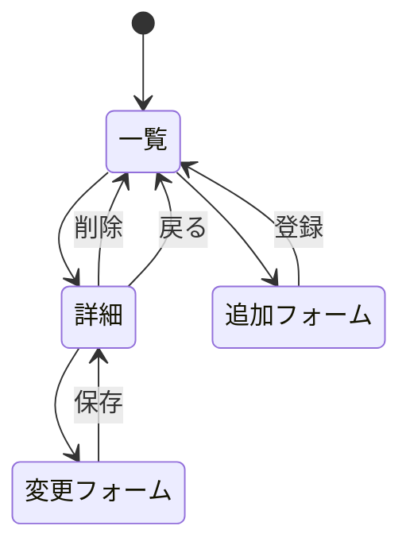

# レポート用に開発するシステムの企画

京葉線システム以外に，次の3つを作る．
どれも自分の生活で実際に出てくるデータなので，自分で使いながら作れるものにした．

1. 友達の遅刻ランキング
2. パーマ記録
3. 写真の撮影メモ帳

3つとも，一覧・詳細・追加・削除・変更ができるようにする．データは変数（配列）に入れる．
URLは今の時点での予定で，REST APIを習ったらそれに合わせて直す．

---

## 1. 友達の遅刻ランキング

### 対象
大学の授業にいつも遅刻してくる友達がいるので，誰が何分遅れたかを記録して，ランキングにする．
使うのは自分と同じ授業を受けている友達．

### スキーマ
| 項目名 | 型 | 内容 |
|---|---|---|
| id | 数値 | 記録のID |
| name | 文字列 | 遅れた人の名前 |
| date | 文字列 | 日付（例：2026-11-13） |
| subject | 文字列 | 遅刻した授業 |
| minutes | 数値 | 遅れた時間（分） |
| excuse | 文字列 | 言い訳 |

### ページ遷移
- 一覧（/chikoku）：遅れた時間の合計が多い順に名前を並べる
- 詳細（/chikoku/:number）：その記録の日付・授業・分数・言い訳
- 追加（/public/chikoku_add.html → /chikoku_add）
- 変更（/chikoku_edit/:number）
- 削除（/chikoku_delete/:number）

---

## 2. パーマ記録

### 対象
毎月パーマをかけているので，いつ・どこで・どんなパーマをかけて，何日くらいもったかを記録する．
次に美容室でオーダーするときに，前の回と比べて見返せるようにする．使うのは自分．

### スキーマ
| 項目名 | 型 | 内容 |
|---|---|---|
| id | 数値 | 記録のID |
| date | 文字列 | かけた日 |
| salon | 文字列 | 美容室の名前 |
| style | 文字列 | パーマの種類 |
| price | 数値 | 料金（円） |
| days | 数値 | もった日数 |
| rating | 数値 | 満足度（1〜5） |

### ページ遷移
- 一覧（/perm）：日付が新しい順に並べる
- 詳細（/perm/:number）
- 追加（/public/perm_add.html → /perm_add）
- 変更（/perm_edit/:number）
- 削除（/perm_delete/:number）

---

## 3. 写真の撮影メモ帳

### 対象
撮った写真のタイトル・場所・日付と，そのときの設定（F値・シャッタースピード・ISO）をメモしておいて，うまく撮れたときの設定を後から見返せるようにする．
使うのは自分．

### スキーマ
| 項目名 | 型 | 内容 |
|---|---|---|
| id | 数値 | 写真のID |
| title | 文字列 | タイトル |
| place | 文字列 | 撮った場所 |
| date | 文字列 | 撮った日 |
| fvalue | 数値 | F値 |
| shutter | 文字列 | シャッタースピード（例：1/250） |
| iso | 数値 | ISO感度 |
| comment | 文字列 | コメント |

### ページ遷移
- 一覧（/photo）：タイトルと日付を並べる
- 詳細（/photo/:number）：設定を全部表示
- 追加（/public/photo_add.html → /photo_add）
- 変更（/photo_edit/:number）
- 削除（/photo_delete/:number）

