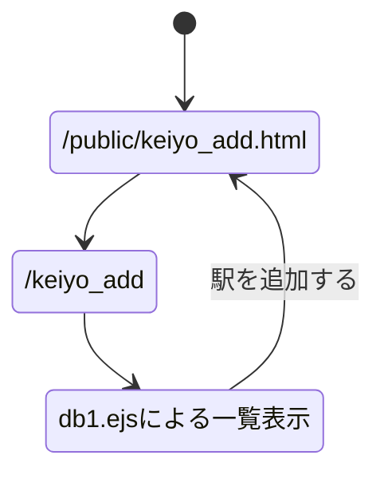
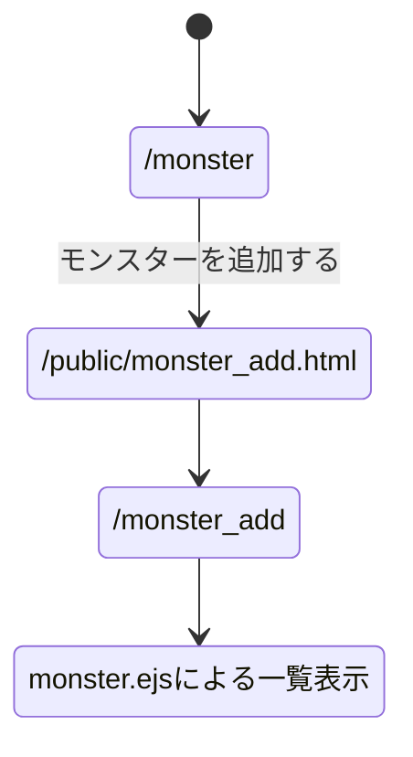

# 第8回 やってみよう

## (1) データ登録後に返すページは入力画面と一覧画面のどちらが良いか

両方試した。

- 入力画面に戻す（`res.redirect('/public/keiyo_add.html')`）と，続けて何個も登録するのは楽だった．でも本当に登録できたのかが画面からは分からないので不安になる．
- 一覧画面を返す（`res.render('db1', { data: station })`）と，今入れたデータが一番下に増えているのがすぐ見えるので，登録できたことが分かる．

なので今回は一覧画面を返すほうにした．一覧の下に「駅を追加する」のリンクを置いたので，続けて登録したいときもすぐ入力画面に戻れる．

## (2)(3) 駅以外のデータの一覧表示と追加

モンハンワイルズの新モンスターの一覧にした．項目は No.・モンスター名・種族・別名．

- 一覧：`/monster`（views/monster.ejs）
- 追加フォーム：`/public/monster_add.html` → `/monster_add` で追加して一覧を返す

